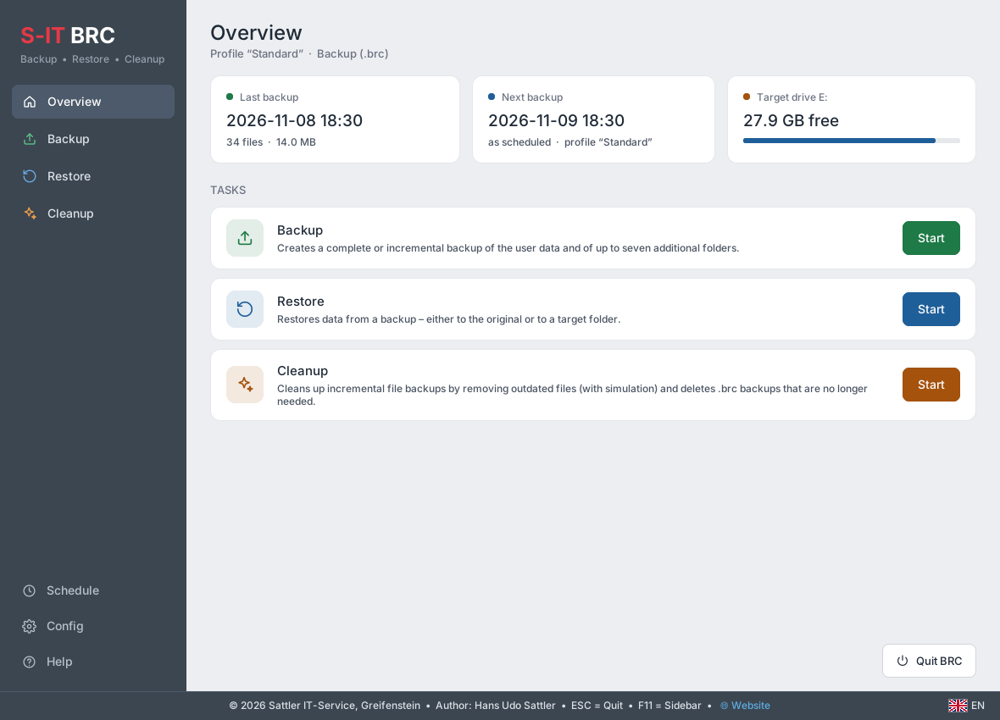
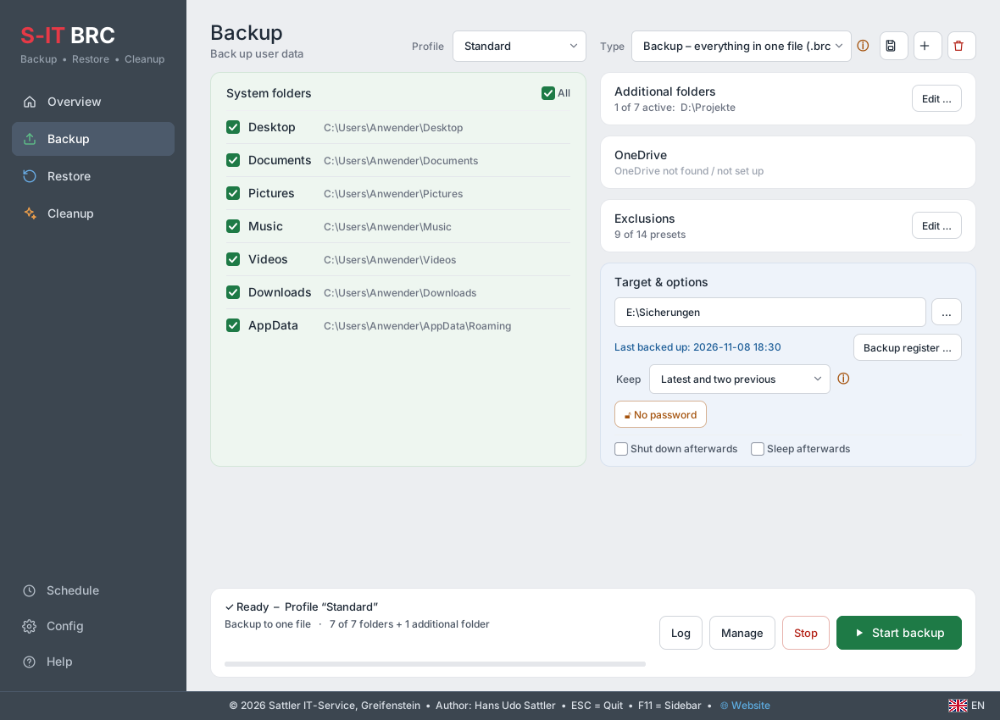
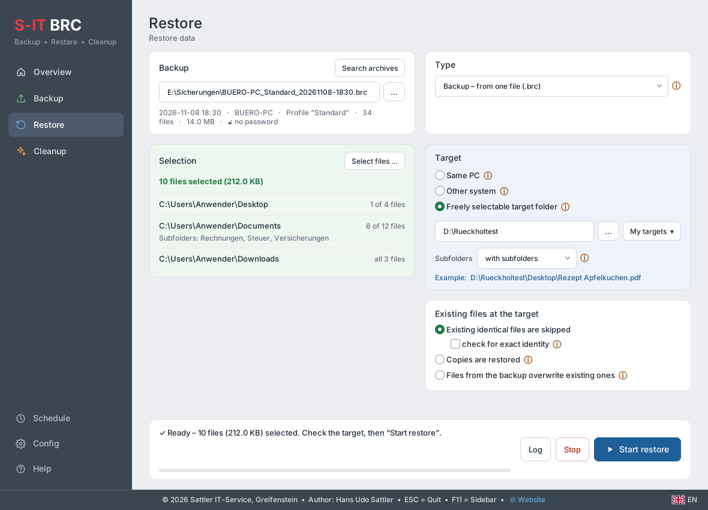
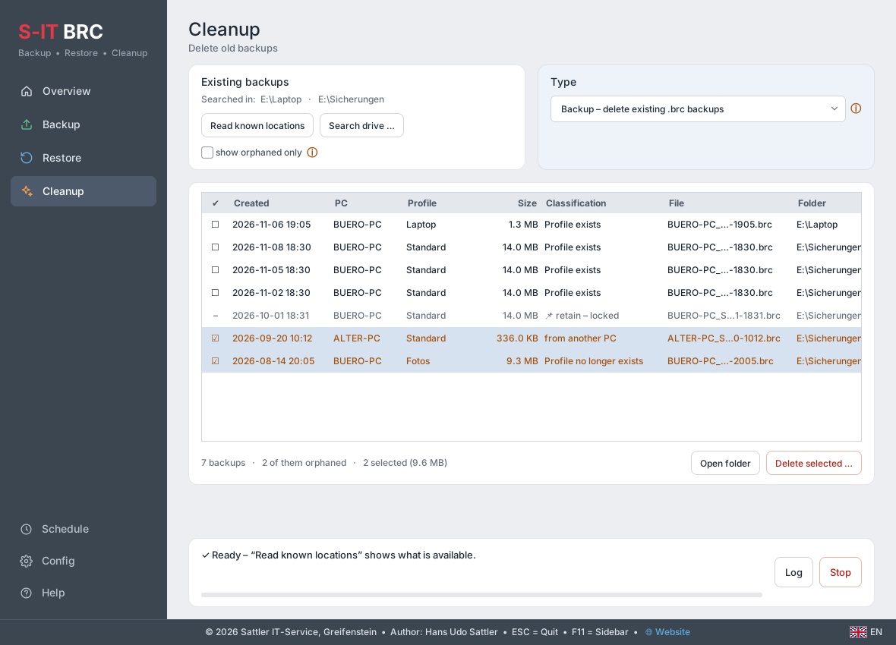

# S-IT-BRC – Backup • Restore • Cleanup

🇩🇪 [Diese Seite auf Deutsch](README_DE.md)

Back up your user data, restore it and tidy up your backups — as a file backup or as a backup to a single file, encrypted if you wish.

Developed by **Hans Udo Sattler · Sattler IT-Service, Greifenstein**

Current version: **v4.0** · Freeware · Windows 10 / 11

---

## What it does

### 💾 Backup
Backs up your personal data (Desktop, Documents, Pictures, Music, Videos, Downloads, AppData), OneDrive and up to seven additional folders to another drive. For each profile you choose the type:

- **File backup** — your files are copied individually into folders on the target drive. Every file can be seen there in Explorer and opened without BRC.
- **Backup (.brc)** — everything is stored in a single file, encrypted with a password (AES-256) if you wish and with several versions. Inside, it is a standard ZIP archive.

A schedule runs your backups automatically — daily, weekly, monthly or at intervals.

### 🔄 Restore
Restores data from a backup — to the original location, to another system or to a freely selectable target folder. From a Backup (.brc) you restore individual folders or files without unpacking the whole backup.

### 🗄️ Cleanup
For the file backup, Cleanup moves files that no longer exist on the PC into an archive folder — with a simulation before the real run. For Backups (.brc) it shows your backups and removes those you no longer need.

## Languages

Program and help are available in Deutsch, English, Français, Español, Nederlands, Italiano, Polski and Hrvatski. A manual in German and in English is included as a PDF.

## System requirements

- Windows 10 or Windows 11 (64-bit)
- The setup requests administrator rights

## Download and installation

The current version is in the [release area](https://github.com/SattlerIT/sit-brc/releases/latest).

The download `sit-brc-V-4_latest.zip` contains the setup and the program archive. Please unpack the zip completely and start `S-IT-BRC-Setup.exe`.

- **Install** — with shortcuts and an entry in the Control Panel
- **Portable** — into a folder of your choice, for example on a USB stick

> **Note:** Windows SmartScreen or a virus scanner may respond at the first start.  
> This is a known false positive with independently developed Windows tools.  
> All files come exclusively from this official GitHub page.

## More information

- [Project page](https://sattlerit.github.io/sit-brc/index_en.html)
- [Changelog](CHANGELOG.md)
- [All S-IT tools](https://sattlerit.github.io/sattlerit-tools/)

## Mentions

- [Deskmodder.de](https://www.deskmodder.de/blog/2026/04/09/s-it-brc-backup-programm-mit-backup-restore-und-auch-einem-cleanup-tool/)

## Licence

© 2026 Sattler IT-Service, Greifenstein · Hans Udo Sattler  
Freeware – free use and redistribution permitted.  
Commercial reuse or modification without permission is not allowed.

Full text in eight languages: [Lizenz-Disclaimer.txt](Lizenz-Disclaimer.txt)

## Contact

**Sattler IT-Service**  
Hans Udo Sattler · Greifenstein  
tool-entwicklung@sattler-it.de
