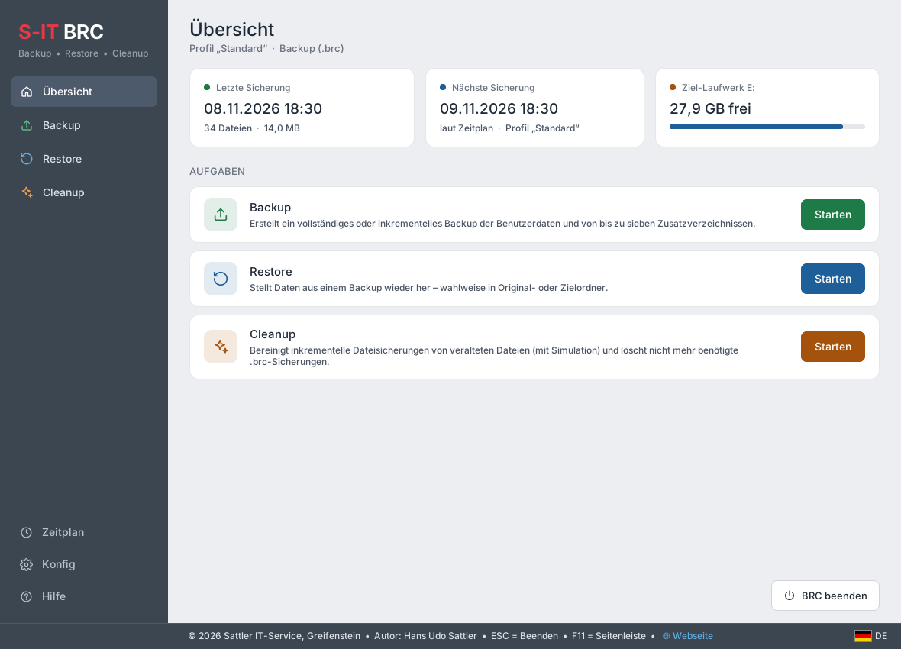
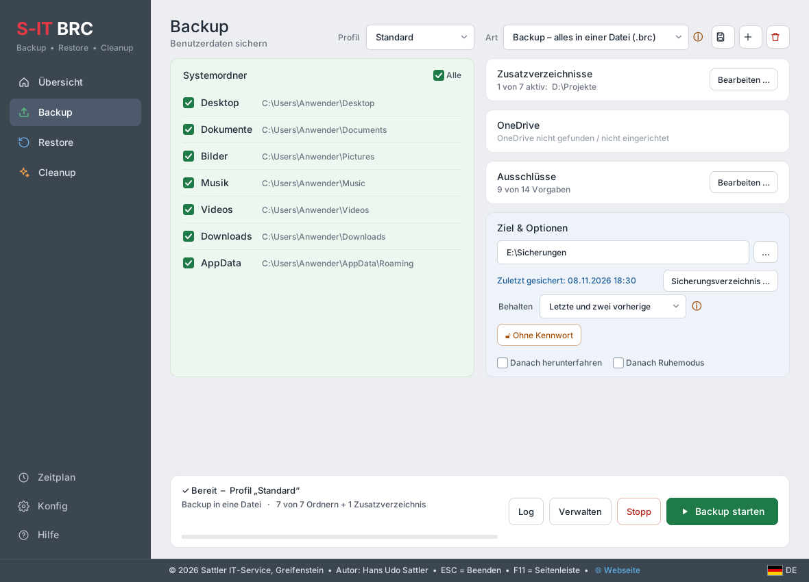
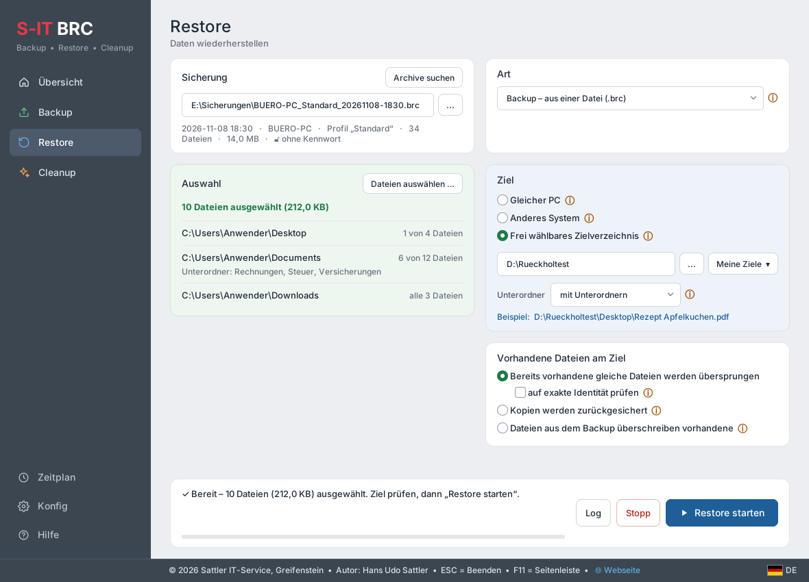
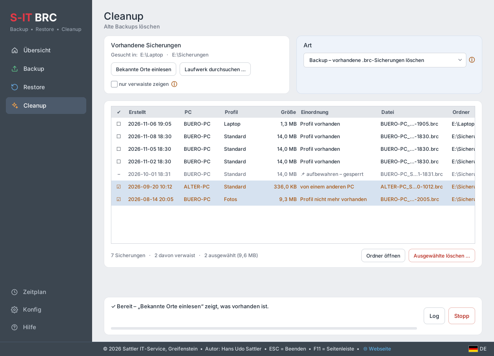

# S-IT-BRC – Backup • Restore • Cleanup

🇬🇧 [This page in English](README.md)

Benutzerdaten sichern, zurückholen und Sicherungen aufräumen — als Dateisicherung oder als Backup in eine einzige Datei, auf Wunsch verschlüsselt.

Entwickelt von **Hans Udo Sattler · Sattler IT-Service, Greifenstein**

Aktuelle Version: **v4.0** · Freeware · Windows 10 / 11

---

## Was das Programm tut

### 💾 Backup
Sichert Ihre persönlichen Daten (Desktop, Dokumente, Bilder, Musik, Videos, Downloads, AppData), OneDrive und bis zu sieben Zusatzverzeichnisse auf ein anderes Laufwerk. Je Profil wählen Sie die Art:

- **Dateisicherung** — Ihre Dateien werden einzeln in Ordner auf dem Ziellaufwerk kopiert. Jede Datei ist dort im Explorer zu sehen und ohne BRC zu öffnen.
- **Backup (.brc)** — alles liegt in einer einzigen Datei, auf Wunsch mit einem Kennwort verschlüsselt (AES-256) und mit mehreren Versionen. Innen ist sie ein ZIP-Archiv nach Standard.

Ein Zeitplan führt Ihre Sicherungen automatisch aus — täglich, wöchentlich, monatlich oder im Intervall.

### 🔄 Restore
Holt Daten aus einer Sicherung zurück — an den ursprünglichen Ort, auf ein anderes System oder in ein frei wählbares Zielverzeichnis. Aus einem Backup (.brc) holen Sie einzelne Ordner oder Dateien zurück, ohne die ganze Sicherung zu entpacken.

### 🗄️ Cleanup
Für die Dateisicherung verschiebt Cleanup Dateien, die es auf dem PC nicht mehr gibt, in einen Archivordner — mit Simulation vor dem echten Lauf. Für Backups (.brc) zeigt es Ihre Sicherungen und entfernt die, die Sie nicht mehr brauchen.

## Sprachen

Programm und Hilfe gibt es in Deutsch, English, Français, Español, Nederlands, Italiano, Polski und Hrvatski. Als PDF liegt ein Handbuch auf Deutsch und auf Englisch bei.

## Systemanforderungen

- Windows 10 oder Windows 11 (64-Bit)
- Das Setup fordert Administratorrechte an

## Download und Installation

Die aktuelle Version steht im [Release-Bereich](https://github.com/SattlerIT/sit-brc/releases/latest).

Der Download `sit-brc-V-4_latest.zip` enthält das Setup und das Programmarchiv. Bitte entpacken Sie die Zip vollständig und starten Sie `S-IT-BRC-Setup.exe`.

- **Installieren** — mit Verknüpfungen und einem Eintrag in der Systemsteuerung
- **Portabel** — in einen Ordner Ihrer Wahl, zum Beispiel auf einem USB-Stick

> **Hinweis:** Windows SmartScreen oder ein Virenscanner können beim ersten Start ansprechen.  
> Das ist ein bekanntes False Positive bei unabhängig entwickelten Windows-Tools.  
> Alle Dateien stammen ausschließlich von dieser offiziellen GitHub-Seite.

## Weitere Informationen

- [Projektseite](https://sattlerit.github.io/sit-brc/)
- [Changelog](CHANGELOG.md)
- [Alle S-IT-Tools](https://sattlerit.github.io/sattlerit-tools/)

## Erwähnungen

- [Deskmodder.de](https://www.deskmodder.de/blog/2026/04/09/s-it-brc-backup-programm-mit-backup-restore-und-auch-einem-cleanup-tool/)

## Lizenz

© 2026 Sattler IT-Service, Greifenstein · Hans Udo Sattler  
Freeware – kostenlose Nutzung und Weitergabe erlaubt.  
Kommerzielle Weiterverwendung oder Modifikation ohne Genehmigung nicht gestattet.

Vollständiger Text in acht Sprachen: [Lizenz-Disclaimer.txt](Lizenz-Disclaimer.txt)

## Kontakt

**Sattler IT-Service**  
Hans Udo Sattler · Greifenstein  
tool-entwicklung@sattler-it.de
